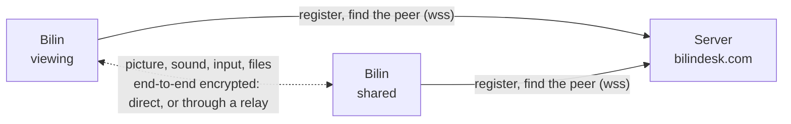

<p align="center">
  
</p>

<h1 align="center">Bilin</h1>

<p align="center">
  Open-source remote desktop for macOS and Windows, reachable from your Android phone too.<br>
  No passwords between your own computers — helping someone else takes just a one-time code.
</p>

<p align="center">
  <a href="LICENSE"></a>
  
  
  
  
  <a href="https://www.bilindesk.com"></a>
</p>

<p align="center">
  <a href="https://www.bilindesk.com/#download"><b>Download</b></a> ·
  <a href="#features">Features</a> ·
  <a href="#how-it-works">How it works</a> ·
  <a href="#building-from-source">Building</a> ·
  <a href="README.md">简体中文</a>
</p>

---

Bilin (比邻, "next door") comes from a Tang dynasty poem: *with a true friend, even the ends of the earth feel like next door.*
The app's interface is in Simplified Chinese for now.

## Features

**My devices**: computers signed in to the same account connect to each other directly — no password, no one needs to
click "Allow" on the other side, even at the lock screen or before anyone has logged in. Restart, shut down, sleep or
sign out remotely, and wake a sleeping or powered-off machine from another one on the same network.

**Helping others**: they read out their device ID and a one-time password, and accept the request on their side.
The password changes after each use. View-only sessions are available, and either side can disconnect at any time.

**Picture**

- Hardware encoding and decoding: HEVC, H.264, AV1 and VP9 — it picks one both GPUs handle, preferring HEVC
- Up to the remote display's native resolution and refresh rate (144 Hz and 240 Hz screens included), up to 150 Mbps
- "Sharper text" (4:4:4 chroma) for code and spreadsheets
- Low-latency mode for snappier response
- Multiple displays, picked from live thumbnails in the toolbar

**Once connected**: sound, clipboard, file transfer (resumes after interruptions), chat, and shortcuts mapped to the
remote system.

**Gets through**: devices on the same network find and connect to each other directly; across networks it punches
through NATs peer-to-peer and falls back to a relay, and the session survives a network change.

**Privacy**: picture, sound, input, clipboard, files and chat are end-to-end encrypted between the two computers. The
server only helps them find each other, and one-time passwords never leave the two devices. No ads, no third-party
analytics.

## Download

| System | Requirements | Download |
| --- | --- | --- |
| macOS | macOS 14 Sonoma or later, Apple silicon | [bilindesk.com](https://www.bilindesk.com/#download) |
| Windows | Windows 10 / 11, 64-bit | [bilindesk.com](https://www.bilindesk.com/#download) |
| Android | Android 10 or later, 64-bit; connects to computers, can't be controlled | [bilindesk.com](https://www.bilindesk.com/#download) |

> The installers are not signed with a paid developer certificate yet. On macOS, the first time you open the installer,
> click "Open Anyway" in System Settings › Privacy & Security. On Windows, when SmartScreen says "Windows protected your
> PC", click "More info › Run anyway". On Android, allow your browser to install unknown apps the first time.

Installed copies check for new versions on their own and offer the update in the sidebar.

## How it works



- Every computer has a 9-digit device ID registered with the server. To connect, the server only passes each side's
  addresses to the other; then the two computers connect directly
- When a direct path is impossible (both behind strict NATs), traffic goes through the server's relay (coturn), which
  only sees encrypted data
- The interface (Qt Quick) and a background service are separate programs: the service runs as a system service from
  boot, so your own devices can reach the computer even when nobody is logged in
- Capture, encoding, transport, encryption and remote input come from the
  [Remote Control SDK](https://github.com/ruoyu-lab/remote-control-sdk) (MIT) by the same author

## Building from source

You need CMake 3.25+, Ninja and Qt 6.10+; Xcode command line tools on macOS, Visual Studio 2022 or later on Windows.

```sh
git clone --recursive https://github.com/ruoyu-lab/bilin-desk.git
cd bilindesk
cmake -S . -B build/debug -G Ninja -DCMAKE_BUILD_TYPE=Debug -DCMAKE_PREFIX_PATH=$HOME/Qt/6.11.2/macos
cmake --build build/debug
open build/debug/App/Bilin.app
```

Windows:

```bat
scripts\build-windows.cmd C:\Qt\6.11.2\msvc2022_64 build\windows D:\Bilin
```

Your own builds connect to a local development server by default (`Server/deploy/setup-dev.sh` sets one up in an OrbStack
VM); add `-DRC_SERVER_URL=wss://www.bilindesk.com/ws` to use the public one. The server, installers and tests are covered in
the [development guide](docs/development.md) (in Chinese).

## Repository layout

```text
App/          the interface (Qt Quick / QML + C++)
Service/      the background service: device identity and the shared side, no UI
Core/         code shared by both: identity, the local link between them, server messages
Server/       the server (Node.js + TypeScript): devices, accounts, presence, signaling, relay credentials;
              admin/ is the admin console
Website/      the website (Vue 3 + TypeScript)
tools/        the Windows installer, a command-line connection tool
scripts/      building, packaging, signing, publishing
docs/         design and development notes
third_party/  Remote Control SDK, QWindowKit
```

## License

Bilin is released under the [GNU Affero General Public License v3.0](LICENSE): you may use, modify and redistribute it;
if you distribute a modified version or run it as a network service, you must publish its source under the same license.

Third-party code: [Remote Control SDK](https://github.com/ruoyu-lab/remote-control-sdk) (MIT),
[QWindowKit](https://github.com/stdware/qwindowkit) (Apache-2.0), [Qt](https://www.qt.io) (LGPL-3.0) and
[Lucide](https://lucide.dev) icons (ISC); see [third_party/README.md](third_party/README.md).
