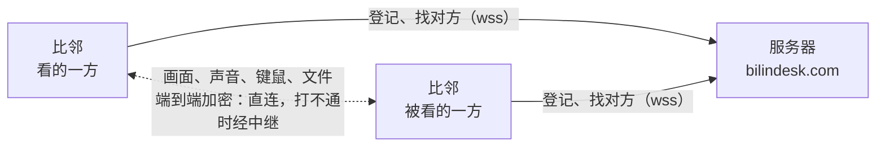

<p align="center">
  
</p>

<h1 align="center">比邻</h1>

<p align="center">
  开源的远程桌面，macOS 和 Windows 互通。<br>
  自己的电脑之间不用密码，帮别人时报一串临时密码就够了。
</p>

<p align="center">
  <a href="LICENSE"></a>
  
  
  
  
  <a href="https://www.bilindesk.com"></a>
</p>

<p align="center">
  <a href="https://www.bilindesk.com/#download"><b>下载</b></a> ·
  <a href="#功能">功能</a> ·
  <a href="#工作原理">工作原理</a> ·
  <a href="#从源码编译">从源码编译</a> ·
  <a href="README.en.md">English</a>
</p>

---

比邻，取"海内存知己，天涯若比邻"：隔得再远，也像在隔壁。

## 功能

**我的设备**：登录同一个账号的电脑互为"我的设备"，打开就能连，不用密码、不用对面有人点允许。
锁屏、还没登录系统时也能连。能远程重启、关机、睡眠、注销；睡着、关机了，还能从同一个网络里的另一台把它叫醒。

**帮别人**：对方报上设备 ID 和临时密码，那边点了"允许"才连得上；临时密码用过一次就换。
只看不操作也行，对方随时能断开。

**画面**

- 用显卡编解码：HEVC、H.264、AV1、VP9，默认挑两边都用显卡编得了的，HEVC 优先
- 分辨率、帧率最高到对方显示器的原生分辨率和刷新率（144 Hz、240 Hz 的屏幕也跟得上），码率最高 150 Mbps
- "文字更清楚"（4:4:4）：看代码、表格时字边不糊
- 低延迟模式：操作以后画面跟得更快
- 多显示器：工具栏上看每块屏幕的缩略图，点哪块看哪块

**连起来以后**：声音、剪贴板、互传文件（断了能接着传）、对话、按对方系统的快捷键。

**连得上**：同一个网络里直接发现、直接连；跨网络时 P2P 打洞，打不通走中继；换网络不断线。

**隐私**：画面、声音、键鼠、剪贴板、文件、对话都在两台电脑之间端到端加密，服务器只帮两边找到对方，
临时密码不上传。没有广告、没有第三方统计。详见[隐私政策](App/legal/privacy.md)。

## 下载

| 系统 | 要求 | 下载 |
| --- | --- | --- |
| macOS | macOS 14 Sonoma 或更新，Apple 芯片 | [bilindesk.com](https://www.bilindesk.com/#download) |
| Windows | Windows 10 / 11，64 位 | [bilindesk.com](https://www.bilindesk.com/#download) |

> 现在还没有付费的开发者证书：macOS 第一次打开安装包时，在"系统设置 › 隐私与安全性"里点"仍要打开"；
> Windows 弹出"Windows 已保护你的电脑"时，点"更多信息 › 仍要运行"。

装好以后会自己检查新版本，在左侧导航栏提示更新。

## 工作原理



- 每台电脑有一个 9 位数字的设备 ID，在服务器上登记。连接时服务器只转交两边"我在哪"的信息，之后两台电脑直接连
- 直连打不通（两边都在严格的 NAT 后面）时，经服务器上的中继（coturn）转发；中继只看得到加密后的数据
- 界面程序（Qt Quick）和后台服务分开：后台服务是系统服务，开机就运行，没人登录时也能被自己的设备连上
- 画面采集、编解码、传输、加密、远程输入都在同一作者的[远程控制 SDK](https://github.com/ruoyu-lab/remote-control-sdk)（MIT）里

## 从源码编译

需要 CMake 3.25+、Ninja、Qt 6.10+；macOS 用 Xcode 的命令行工具，Windows 用 Visual Studio 2022 或更新版本。

```sh
git clone --recursive https://github.com/ruoyu-lab/bilin-desk.git
cd bilindesk
cmake -S . -B build/debug -G Ninja -DCMAKE_BUILD_TYPE=Debug -DCMAKE_PREFIX_PATH=$HOME/Qt/6.11.2/macos
cmake --build build/debug
open build/debug/App/Bilin.app
```

Windows：

```bat
scripts\build-windows.cmd C:\Qt\6.11.2\msvc2022_64 build\windows D:\Bilin
```

自己编的程序默认连本机的开发服务器（`Server/deploy/setup-dev.sh` 建，在 OrbStack 的虚拟机里），
连正式的服务器加上 `-DRC_SERVER_URL=wss://www.bilindesk.com/ws`。服务端、安装包、测试见[开发文档](docs/development.md)。

## 目录

```text
App/          界面程序（Qt Quick / QML + C++）
Service/      后台服务：本机身份、被连的那一面，没有界面
Core/         两个程序共用的部分：本机身份、两者之间的本机连接、和服务器之间的消息
Server/       服务端（Node.js + TypeScript）：设备登记、账号、在线、转发信令、发中继凭据；admin/ 是管理后台的网页
Website/      官网（Vue 3 + TypeScript）
tools/        Windows 的安装程序、命令行连接工具
scripts/      编译、打包、签名、发布
docs/         设计和开发文档
third_party/  远程控制 SDK、QWindowKit
```

## 文档

- [设备和账号](docs/devices-and-accounts.md)：设备 ID、账号、我的设备、远程重启和网络唤醒
- [会话里的画面](docs/session.md)：分辨率、帧率、编码器、文字更清楚、低延迟模式
- [网络](docs/network.md)：怎么找到对方、直连和中继、服务器
- [安装和第一次运行](docs/install-and-first-run.md)：安装包、系统服务、无人值守、授权
- [手机版](docs/mobile.md)：Android 连电脑（开发中）
- [开发](docs/development.md)、[测试](docs/testing.md)、[管理后台](docs/admin.md)、[官网](docs/website.md)

## 许可

比邻以 [GNU Affero General Public License v3.0](LICENSE) 发布：可以自由使用、修改、分发；改过的版本拿去分发，
或者用它对外提供服务，要以同样的许可公开源码。

用到的第三方代码：[远程控制 SDK](https://github.com/ruoyu-lab/remote-control-sdk)（MIT）、
[QWindowKit](https://github.com/stdware/qwindowkit)（Apache-2.0）、[Qt](https://www.qt.io)（LGPL-3.0）、
[Lucide](https://lucide.dev) 图标（ISC），详见 [third_party/README.md](third_party/README.md)。
